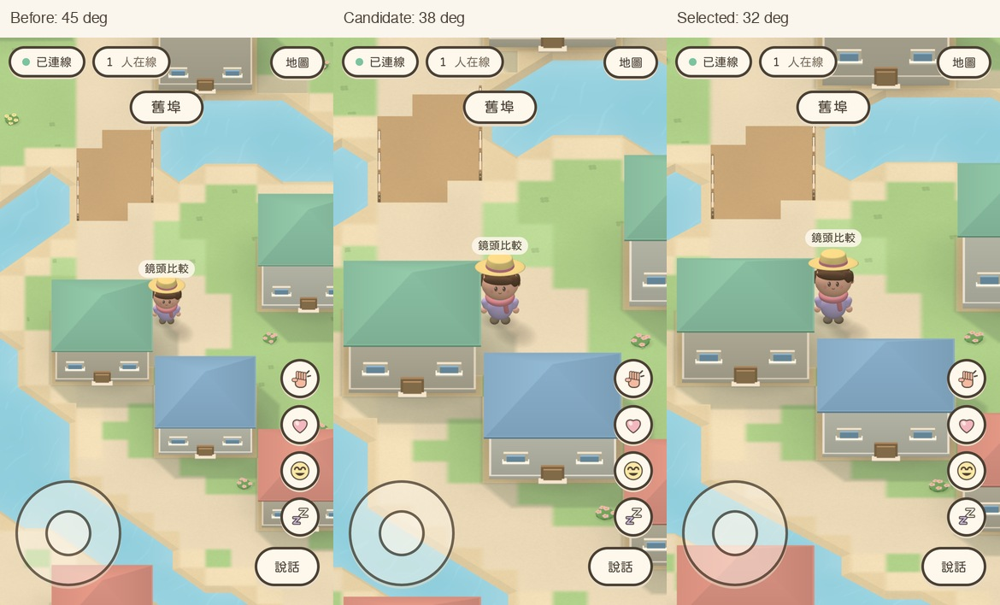
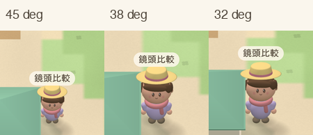
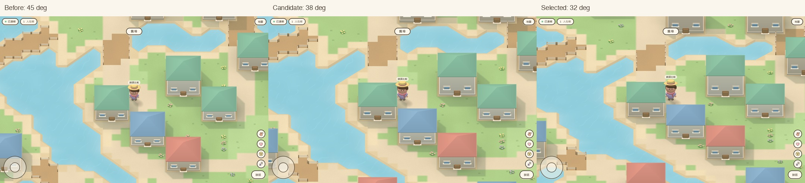
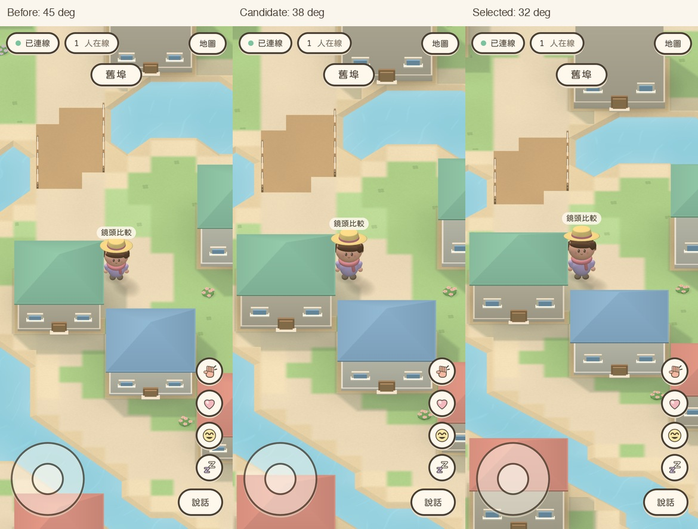
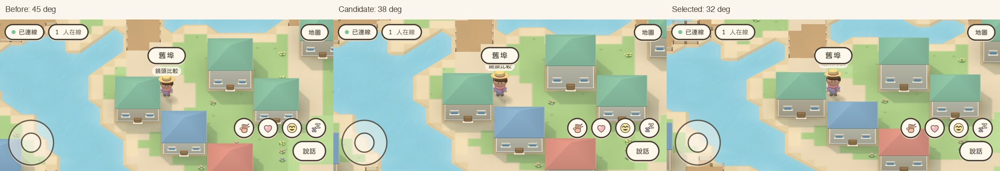

# Lower camera and mobile composition

Validated in Apple Container on 2026-10-24, from main `49063675558ef96eaaef25c9eb9cf2a568afde27`. PR #25 was already merged; its checks and the latest main CI were successful. The existing isolated worktree and untracked QA artifacts were preserved.

## Decision and parameters

The owner selected **32 degrees** after comparing 45, 38 and 32 degrees in the same actual game scenes. Only the camera frame, pitch and a small name/bubble anchor clearance changed; character and scene geometry, movement, server correction and collision rules remain unchanged.

- Orthographic pitch: 45 → 32 degrees down from horizontal; yaw remains zero.
- Distance remains 60 tiles, near/far remain 1/160. Height falls from 42.43 to 31.80 tiles, but distance/height do not determine orthographic object size.
- Portrait image-plane height cap: 22 → 20 tiles. Below that cap the frame uses 9.5 tiles across, keeping character scale almost constant as Safari bars reduce available height.
- Wide viewports: 90% of the former width; 30 → 27 tiles across at 1440×900.
- Projected name/bubble anchor: AVATAR_TOP + 0.08 tiles. At the lower pitch the rear brim projected about one pixel above the old vertical anchor. The added clearance keeps names above the hat; all hats and four headings are covered by a geometry test.

## Actual rendered comparisons

Every column uses the same fixed spawn, downward facing direction, sunhat/purple-shirt/scarf outfit and viewport. These are screenshots of the running WebKit game, resized only for comparison. They are not illustrations or photographs of a physical iPhone.

### Phone, available viewport 390×664



[Original-resolution before](iphone-bars-before.jpg) · [Original-resolution final 32-degree after](iphone-bars-after.jpg)

### Face detail, same screen scale



### Desktop, 1440×900



[Original-resolution before](desktop-before.jpg) · [Original-resolution final 32-degree after](desktop-after.jpg)

### Additional viewport coverage





## Measurements

The heights below project the vertices of the actual stationary avatar geometry, including hat depth, rather than just multiplying its vertical axis by cos(pitch). Units are CSS pixels. Geometry projection is a reproducible measurement; pixel-edge antialiasing can differ slightly in screenshots. Ground depth is the flat-ground span of the full canvas, before UI coverage.

| Viewport | Pitch | Width in tiles | Ground depth in tiles | Avatar silhouette height |
| --- | ---: | ---: | ---: | ---: |
| 390×664 | 45° baseline | 12.92 | 31.11 | 58.9px |
| 390×664 | 38° candidate | 9.50 | 26.27 | 84.8px |
| 390×664 | **32° selected** | **9.50** | **30.52** | **87.9px** |
| 390×844 | 45° baseline | 10.17 | 31.11 | 74.9px |
| 390×844 | **32° selected** | **9.24** | **37.74** | **90.3px** |
| 750×342 | 45° baseline | 28.85 | 18.60 | 50.7px |
| 750×342 | **32° selected** | **25.96** | **22.34** | **61.8px** |
| 1440×900 | 45° baseline | 30.00 | 26.52 | 93.7px |
| 1440×900 | 38° candidate | 27.00 | 27.41 | 110.2px |
| 1440×900 | **32° selected** | **27.00** | **31.84** | **114.2px** |

At 390×664 the character is about 49% taller, houses are about 36% wider, and a fixed-height wall projects about 63% taller. At desktop size those changes are about 22%, 11% and 33%. Portrait character height now changes only about 2.8% between 664 and 844 available pixels, instead of 27.1%.

[Full frame/geometry measurements](geometry-metrics.json) · [Rendered scene counters, positions and local socket URLs](metrics.json)

## Visual observations

- The 32-degree view exposes more face below the brim: eyes, cheeks and the lower face read more clearly. The head and body geometry were not altered.
- Roofs occupy less vertical space relative to the taller facades. Windows, doors and the gaps between houses are easier to read.
- The bridge, road and riverbank remain visible in the street scene. At the shorter phone height the ground span is almost the same as before, despite the larger figure.
- Street and wooded spawn captures show the complete player, clear of foreground houses/trees and the joystick/emote controls. In landscape the temporary district banner sits close above the name but does not cover the character.
- No terrain holes or far-plane clipping were observed in the captured scenes. Unit tests also check viewport corners at ground and elevated planes.
- The owner preferred 32 degrees to the more conservative 38-degree candidate. Its tradeoff is more distant ground and more geometry submitted by region-level culling.

## Automated validation

All source edits, dependency installation, tests, builds and browser processes ran inside Apple Container. Host tools were used for Git/GitHub metadata and viewing saved screenshots; no host development dependencies were installed.

- Lint, Typecheck and Build passed. The existing client bundle-size warning remains.
- **189 unit/integration tests passed**, including camera projection round trips, terrain picking, clipping bounds, browser-bar scale stability, every hat/head direction, collisions, server validation and the existing movement jitter regression.
- **64 WebKit tests passed** across iPhone/iPad portrait and landscape with the 32-degree camera.
- After the final 0.08-tile overlay clearance, **24 avatar/3D/multiplayer tests** and **8 dedicated screenshot/anchor tests** passed again.
- **7 desktop WebKit tests passed**, covering the reference outfit, actual joystick pointer input, both 2D/3D tap movement at 24/30fps simulation steps and the two fixed screenshot scenes.
- Low-FPS movement retains exact arrival, zero reverse steps and zero server corrections. These are simulation-step tests, not claims about hardware FPS.
- Screenshot tests assert the name's horizontal alignment and clearance above the projected hat, nonzero rendering, draw-call/triangle budgets, and exclusively loopback game WebSockets.

Reproduce inside a container with the repository mounted at /work:

```sh
npm run lint
npm run typecheck
npm test
npm run build
npx playwright test
npx playwright test -c playwright.camera.config.ts
```

The base suite starts a local server/static client. Each fixed-scene test uses its own local multiplayer stack and never the production service. Other players are real protocol-speaking WebSocket clients, which the WebKit browser renders; they are not a second physical device.

## Performance and remaining limits

At 390×664, street rendering changed from 41 calls / 48,852 triangles to 45 calls / 87,322 triangles. At 390×844 it changed from 39 / 47,054 to 48 / 118,578. Desktop changed from 52 / 78,691 to 65 / 133,488. These remain below the screenshot budgets of 150 calls and 300,000 triangles, but the increased geometry is real. Software-rendered Container WebKit cannot establish real iPhone GPU performance or a 60fps guarantee.

Actual device Safari, animated address/tab bars, safe-area differences, keyboard behavior and thermal performance still require owner testing. Fresh 664px and 844px contexts plus unit tests model changing available height; they do not reproduce Safari's toolbar animation. Captured street/woodland scenes and existing movement tests do not prove every possible building/tree approach is unobstructed. The camera remains fixed and has no new obstacle fading.

No PR merge, production deployment or production configuration change was performed.
