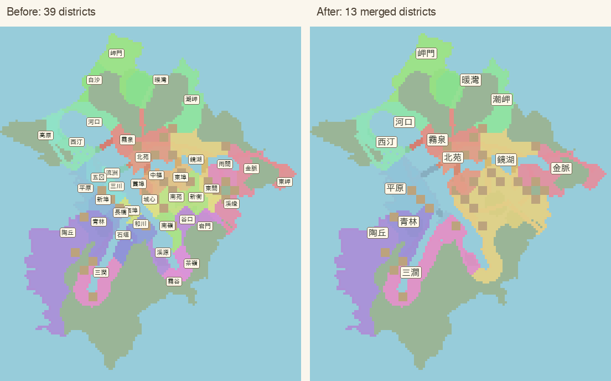
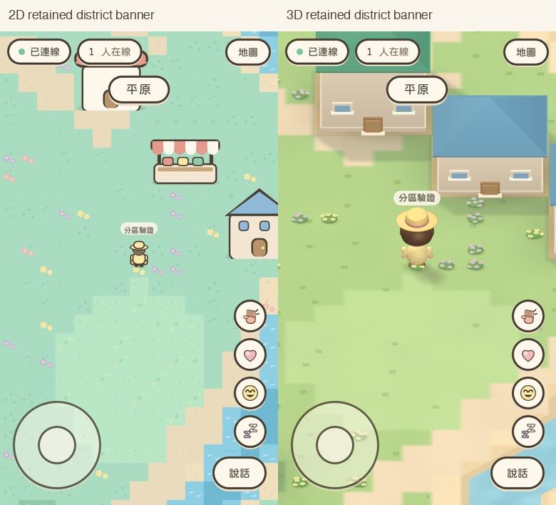

# Merge 39 districts into 13

Based on main ada85b527deb72b9449dfd0a376348073592b1ac. All development and local verification ran in Apple Container in the existing isolated worktree.

## Retained names and complete merges

The thirteen former districts with the largest walkable coverage are retained. Each smaller district joins a connected group under a retained name. Every retained name originally owned more ground than each of its absorbed members.

| Retained name | Absorbed former districts | Original walkable tiles | Merged walkable tiles |
| --- | --- | ---: | ---: |
| 陶丘 | — | 790 | 790 |
| 岬門 | 白沙 | 284 | 360 |
| 潮岬 | — | 260 | 260 |
| 鏡湖 | 東埠、東關、城心、南苑、新衡、南嶺、谷口、岩門、茶嶺、霧谷、溪燈 | 246 | 1113 |
| 三澗 | 和川、石垣、溪源 | 218 | 466 |
| 青林 | 長橋 | 210 | 254 |
| 霧泉 | — | 191 | 191 |
| 暖灣 | — | 178 | 178 |
| 金脈 | 雨關、東岬 | 166 | 341 |
| 北苑 | 舊埠、中樞 | 163 | 269 |
| 西汀 | 高原 | 145 | 257 |
| 河口 | — | 136 | 136 |
| 平原 | 西埠、流洲、三川、五汊、新埠 | 124 | 423 |

The map retains all 5,038 walkable tiles and 28 buildings. Terrain, roads, rivers, props, movement/collision rules, camera and lighting are preserved.

## Actual tile ownership

These are diagnostic diagrams of actual tile ownership. Colored cells are walkable district territory; muted terrain is non-walkable scenery. The right panel displays exactly thirteen names. [Before](before.png) · [After](after.png) · [Merge table](merges.json)

The public zones list contains 13 anchors. Each group retains its former internal coverage seeds and original priority. The existing flood fill therefore produces complete former-region unions while preserving external borders and deterministic ties. The public Zone interface remains unchanged.

The generator validates one complete membership for every former site and reproduces the grouping. Map-data version increases to 3; the network protocol is unchanged.

Exhaustive comparison across all 21,760 map cells found zero differences from original ownership relabelled by this table. The terrain grid is unchanged, and regenerating town.json reproduces the checked-in data exactly.

## Real game captures and checks

These are local WebKit game screenshots with emulated viewports, not physical-device Safari captures.

The browser route starts at (48,85), formerly 長橋. Walking to (47,85), formerly 青林, now stays in 青林 without resetting its banner. The next tile (47,84) enters 平原 and announces that name.

- Lint, Typecheck, Build and 190 unit/integration tests passed.
- Eight district-specific browser checks passed in 2D/3D on iPhone/iPad portrait and landscape.
- Regression checks enforce exactly 13 retained names, the complete relabelled ownership fingerprint, connected district coverage and sufficient area.
- Street/park arrivals span 10 of the 13 districts; other coasts remain reachable on foot.
- The full 72-case WebKit suite includes existing multiplayer, 2D/3D movement and low-FPS arrival regression checks. Its remote result is shown in the PR checks.

~~~sh
node scripts/build-map.mjs
npm run lint
npm run typecheck
npm test
npm run build
npx playwright test
~~~

No production configuration change, merge or production deployment was performed.
