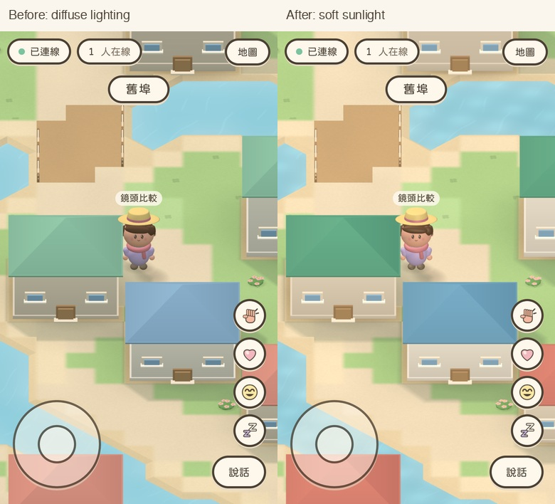
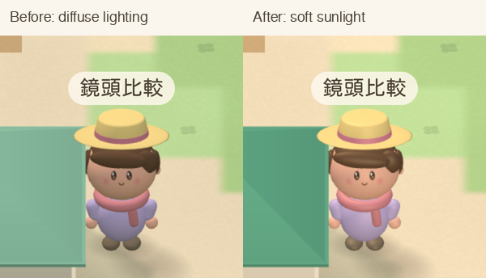
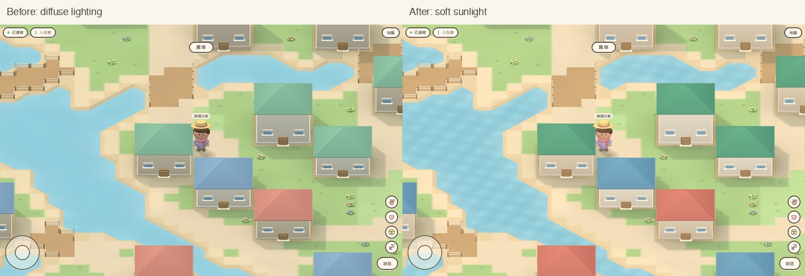
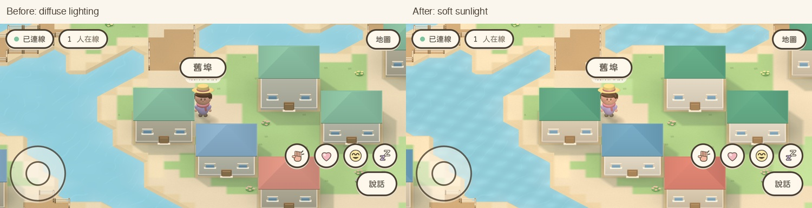

# Soft sunlight and restrained surface sheen

Compared and validated in Apple Container from main `5246a24e9d022d62ba3e190d17ef33e5e26d9c0a`, retaining the 32-degree camera selected in PR #26. The supplied reference and current phone image were inspected as visual references. They were not copied into game assets.

## Visible changes

- Warm front bounce lifts the gray cast from house facades and the face. The fill is almost horizontal so it does not wash out grass and water.
- Rounded characters, faces and painted props now have restrained Phong specular response. The face uses less reflectance than the body, keeping eyes and expression readable.
- Roof paint has deeper 3D-only colors to retain color separation under brighter daylight. The shared 2D palette is unchanged.
- Water has low-strength highlights following analytic ripple normals. The water geometry and terrain picking stay flat.
- Static sun-shadow feathering is wider: 0.18/0.22 → 0.28/0.30 tiles for buildings/canopies.
- Ground retains the existing matte Lambert material. No bloom, screen-space pass, shadow-map render pass, downloaded texture, environment map or new per-frame CPU work was added.

The initial glossy candidate showed oversized water glare and a strong hair streak. The final version reduced reflectance, lowered the fill angle and deepened roof pigment. The reference's soft daylight is the direction for this change; the result still uses the game's existing simplified geometry.

## Actual game captures

Identical fixed spawn, outfit, direction, 32-degree camera and viewport. All images are running Container WebKit captures, rather than generated illustrations or physical-device screenshots.



[Original phone before](phone-before.jpg) · [Original phone after](phone-after.jpg)





[Original desktop before](desktop-before.jpg) · [Original desktop after](desktop-after.jpg)



## Settings

| Setting | Before | Final |
| --- | --- | --- |
| Hemisphere sky / bounce | #f1f8ff / #9fae89, 1.65 | #f5f8ff / #c5bda1, 1.75 |
| Sun color / intensity | #fff1dd / 1.9 | #ffefd8 / 2.1 |
| Front fill color / intensity | #fff8ec / 0.5 | #fff3df / 1.25 |
| Front fill position | (1, 2, 4) | (1, 1, 5) |
| Props | diffuse Lambert | Phong, #393b32 reflectance, shininess 18 |
| Character body | diffuse Lambert | Phong, #554938 reflectance, shininess 20 |
| Face | diffuse Lambert | Phong, #262016 reflectance, shininess 24 |
| Water | diffuse Lambert | Phong, #36515b reflectance, shininess 40 |

Sun direction, camera frame/pitch, object geometry, movement, collision, server speed validation and the 2D renderer were preserved. Only the static shadow feather geometry gains a small number of triangles.

## Visual observations

Facades read as warm cream instead of gray. The hat, hair, scarf and rounded shoulders have distinct soft highlights, while the dark eyes and cheeks remain visible. Roofs retain richer red/blue/green paint. The final water keeps its blue base and subtle bright ripples without the initial candidate's broad white pools. Shadows still attach buildings/trees to the ground and have softer edges.

No missing terrain or new self/UI occlusion was observed in street and wooded captures at phone full height, phone reduced height, landscape and desktop. This does not cover every possible map position.

## Automated verification

All edits, dependency commands, builds, tests and browser processes ran in Apple Container. Local multiplayer servers and clients were used throughout; captures assert loopback WebSocket URLs. Screenshot tests now also fail on browser console errors, including shader compilation failures.

- Lint, Typecheck and Build passed; the existing bundle-size warning remains.
- 189 unit/integration tests passed.
- The first full WebKit run passed 63/64 cases. One iPad tap-movement smoke case timed out with the software-rendering low-FPS prompt visible; three consecutive isolated reruns passed. The failure was preserved and no wait, movement or server rule was relaxed. All fixed 24/30fps simulation-step jitter cases passed with zero reversals and zero server corrections.\n- Other coverage includes real join/movement/joystick paths, local protocol clients, speech bubbles, 30-player display and both 2D/3D modes.
- Six additional fixed-scene viewport captures passed, verifying full/reduced phone heights and desktop, with rendering budgets and projected name/hat alignment.

Street rendering remains 45 calls on the reduced-height phone and 65 calls on desktop. Triangles change from 87,322 to 87,509 on the phone and from 133,488 to 133,675 on desktop because of the wider shadow feather. Fragment shading costs more than diffuse-only shading; unchanged draw calls do not establish unchanged GPU time.

```sh
npm run lint
npm run typecheck
npm test
npm run build
npx playwright test
npx playwright test -c playwright.camera.config.ts
```

## Matched software-rendering sample

A separate baseline client build and the final build used the same private server, fixed spawn, outfit and device viewport. After 8.5 seconds of warmup, a 4-second requestAnimationFrame sample measured:

| Emulated viewport | Baseline | Final |
| --- | ---: | ---: |
| iPhone 390×664, DPR capped at 2 | 23.75 fps | 20.98 fps |
| iPad 810×1080, DPR 2 | 8.86 fps | 8.20 fps |

This is a single Container software-rendering sample per variant, not a hardware benchmark or a real Safari result. It indicates added fragment cost (about 12% / 7% lower software FPS), rather than unchanged performance. The baseline itself was already below the fallback threshold on software-rendered iPad. [Raw sample data](software-rendering.json)

## Limits

These are emulated WebKit viewports, not a real iPhone Safari verification. Hardware FPS, thermal behavior, Safari toolbar animation and display color differences remain device checks. No full lighting simulation or self-shadowing was added, and the existing simple meshes, roof edges and terrain construction remain visible. No production configuration change, merge or production deployment was performed by this work.
