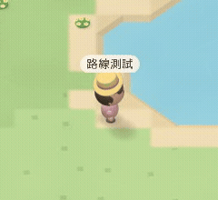

# Tap movement jitter regression

Validated in Apple Container on 2026-10-24. Branch fix/tap-movement-jitter starts from main 7a3f70149e98c6e3cf9df6ed30e08f27ddfba824, after PR #21 was confirmed merged. The supplied phone recording was decoded and inspected locally; it has not been added to the repository.

## Root cause

Both renderers call ClientWorld.followPath. It always advanced by WALK_SPEED_PX * frameSeconds, even when the next waypoint was closer than that distance. At 30fps, a 32px leg needs 7.5 steps of about 4.27px. After seven steps the remaining distance is about 2.13px, outside the old 1.5px arrival threshold. The next step crosses the waypoint, and the following frame reverses back across it. This can repeat indefinitely and also flips facing/camera follow.

Phaser initially clamps/smooths frame deltas, so a short 2D test immediately after startup can hide the issue. After its warmup, the same shared path code can reverse. Neither before-case received a server correction.

## Fix

Spend each frame's existing movement budget on at most the remaining distance to a waypoint. Arrive exactly, advance the route, and carry leftover distance into the next leg. Stop through the existing collision path when movement is blocked. Remove the arbitrary 1.5px arrival snap.

The server speed guard, WALK_SPEED, collision footprint, pathfinding, renderer and WebSocket protocol were not changed.

## Recorded browser evidence

These cropped/scaled GIF excerpts come from actual containerized WebKit recordings, using a fixed spawn and the same tap target.

| 3D before | 3D after |
| --- | --- |
|  |  |

| 2D before | 2D after |
| --- | --- |
|  |  |

The 3D excerpts cover the movement/arrival interval before the expected low-FPS performance prompt. Full uncut browser videos, screenshots and the original traces remain locally in qa-artifacts. No prompt was removed from the product.

30fps simulation-step browser results over four seconds:

| View | Before reversals | Before arrived | After reversals | After arrived | Server corrections before / after |
| --- | ---: | --- | ---: | --- | --- |
| 2D | 1 | Yes, after reversing | 0 | Yes, stable | 0 / 0 |
| 3D | 45 | No | 0 | Yes, stable | 0 / 0 |

[2D before trace](before-2d.json) · [2D after trace](after-2d.json) · [3D before trace](before-3d.json) · [3D after trace](after-3d.json)

## Regression coverage

The pre-fix unit run failed three cases: 30fps straight, 24fps diagonal, and variable mobile frame timing. All now pass. Tests also enforce the per-frame speed budget, full use of leftover distance on a straight route, exact arrival/stopping, and collision-safe turns around a wall.

The new WebKit scenario:
- Paces callbacks while providing deterministic 24fps or 30fps simulation timestamps. This tests frame-step handling, not actual hardware FPS.
- Waits through Phaser's initial frame-smoothing window for 2D.
- Performs an actual touch tap on mobile or mouse click on desktop.
- Records position every 30ms, checks exact arrival, zero reverse progress on a clear route, ten final stationary samples and zero server corrections.
- Saves motion JSON, screenshots and video. Existing tests only checked entry into a target tile, which could miss waypoint oscillation inside that tile.

## Validation

Every source edit, dependency command, test, build and browser capture ran inside Apple Container.

    npm test
    npm run typecheck
    npm run build
    npm run lint
    npx playwright test

- **186 unit/integration tests passed.**
- **Typecheck, Build and Lint passed.** Existing bundle-size warning remains.
- **56 WebKit tests passed** across iPhone/iPad portrait and landscape.
- **4 desktop WebKit tests passed** at 1440x900, covering both views and both low-FPS steps.
- All fixed low-FPS cases reached their target and remained stationary with zero reversals and zero server corrections.
- Existing multiplayer, 30-player rendering, joystick movement, 2D/3D choice and layout checks remain passing.

Full logs remain under qa-artifacts/tap-*.log in the isolated worktree. No merge, production deployment or production settings change was performed. Actual deployment still requires owner review.
