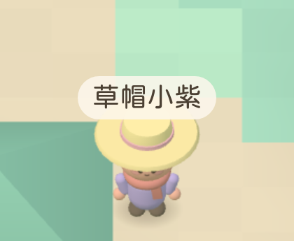
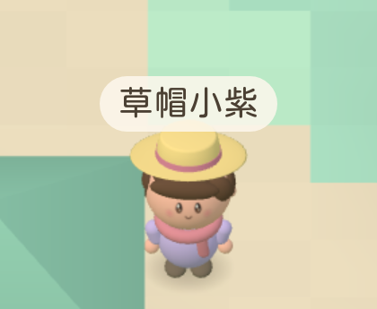

# Avatar readability visual QA

Validated on 2026-10-24 in Apple Container on macOS arm64. All dependency installation, source edits, builds, unit tests and browser tests ran inside Linux containers. Screenshots below were captured by containerized WebKit against the actual built game, not generated illustrations.

## Controlled comparison

Same fixed-spawn test server, viewport, camera framing, scale (1.85) and selected outfit: skin 1, shirt 5 (lilac), sunhat, scarf. Before uses PR #18 avatar geometry; after uses this branch. The preview camera uses the new fit for both. The cropped images are original browser screenshot clips, without rescaling or retouching.

| Before | After |
| --- | --- |
|  |  |

[Full iPhone game capture](iphone.png) · [Full 1440x900 desktop capture](desktop.png)

## Observations

- Raised, shallower, backward-tilted straw brim exposes the fringe, eyes and cheeks from the existing 45-degree camera.
- Swept fringe, side locks, rounder head, warm highlighted eyes, blush and smile read at game scale.
- Rounded lilac outfit, small sleeves/hands, and a soft coral scarf replace the thin capsule silhouette for this selected outfit.
- Preview framing and name-tag anchor accommodate the taller hat without clipping.
- Walking screenshot inspection confirms the hat and face turn with the character.
- The renderer still batches each avatar body into one cached geometry; faces and shadows stay instanced.

## Automated validation

- Node 22-slim container: npm ci previously succeeded; npm test **174 passed**, npm run typecheck, npm run build, npm run lint passed on final source.
- Official Playwright v1.64.1-noble container, 4 GB / 6 CPUs: **32 passed** across iPhone, iPhone landscape, iPad, iPad landscape.
- Separate desktop WebKit container, 1440x900: **1 passed**.
- Existing coverage checks tap movement, layout, chat/emotes, 2D fallback and 30 nearby avatars below 150 draw calls.
- Added geometry checks cover all 25 hat/accessory combinations for finite coordinates, ground contact, overlay bounds and cache reuse.
- Added visual test captures a fixed reference outfit, drags the real joystick with pointer input, verifies movement and joystick release, and saves a walking frame.
- Build retains the existing large-bundle warning.

Commands (inside the repository mount at /work):

    npm test
    npm run typecheck
    npm run build
    npm run lint
    npx playwright test

Desktop used a temporary config extending the repository config, with WebKit, viewport 1440x900, DPR 1, isMobile false, hasTouch false and /work as webServer cwd. Full logs and per-device images remain in the isolated worktree's qa-artifacts directory.

## Limits and next work

WebKit device emulation and pointer-driven joystick coverage do not establish actual iPhone Safari GPU/battery performance or physical multitouch behavior. Manual visual review focused on the reference outfit; other combinations have geometry coverage, not a full visual approval. Scene lighting, flat terrain colors, square banks and sparse planting still differ substantially from the reference. A subsequent scene pass should address those independently, with the same captured views.

This branch is based on the still-open PR #18 camera branch. No production settings were changed and no merge or deployment was performed.
