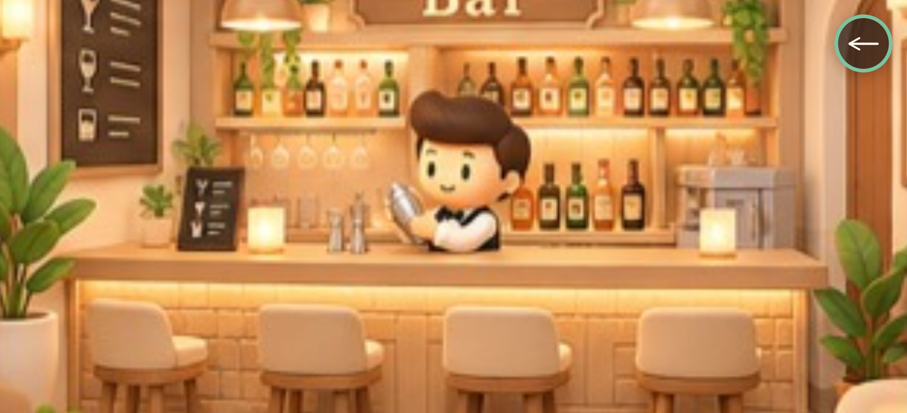
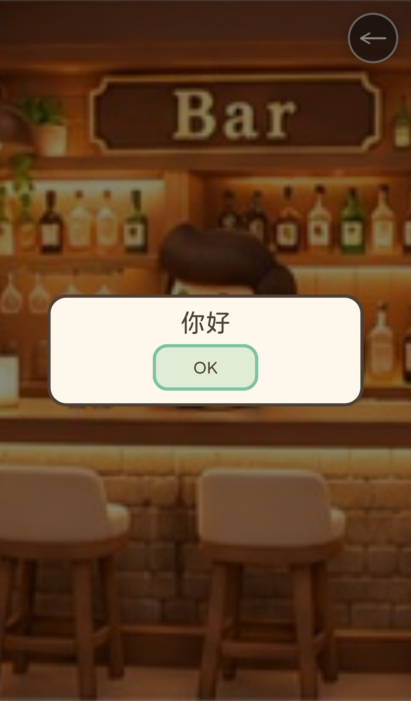

# Full-screen bar interiors

2026-10-25 · branch: `codex/house-bar-interiors`

The front-row house actions now include **進入屋子** below **閱讀告示牌**.
Each of the twelve houses opens its own panel from the user's twelve-style
bar reference. The supplied JPG is included unchanged and fetched only when
first entering an interior. Source attribution is recorded in ASSET_LICENSES.md.

The image fills the complete game viewport edge to edge in portrait and
landscape, preserving aspect ratio and cropping to cover. There is no header,
house/style caption, instruction text or scene frame. Only a small safe-area
return arrow floats over the image. House/style labels remain available to
assistive technology without being displayed.

Clicking anywhere in the scene opens **你好** with an **OK** button. OK/Escape
dismiss the greeting while remaining inside. The return arrow or Escape from
the room returns to the same outdoor position and restores focus/movement.
The existing house introduction remains usable.

Interiors are local image views rather than additional multiplayer rooms.
Outdoor movement is paused; no room geometry or new server messages are added.

## Verification

- Type checking, ESLint, 219 unit tests and production build passed.
- **32 WebKit scenarios passed**, covering 2D/3D, two different house styles, all four iPhone/iPad
  orientations, exact viewport-edge coverage, absence of captions, greeting/OK,
  image loading, pause/resume, return focus and noticeboard compatibility.
- Unit checks cover all twelve unique house/panel/style assignments and crop
  bounds inside the supplied image.
- Existing large-bundle warning remains.

Run `npm run build`, then:

```sh
npx playwright test e2e/bar-interiors.spec.ts e2e/house-notices.spec.ts
```





