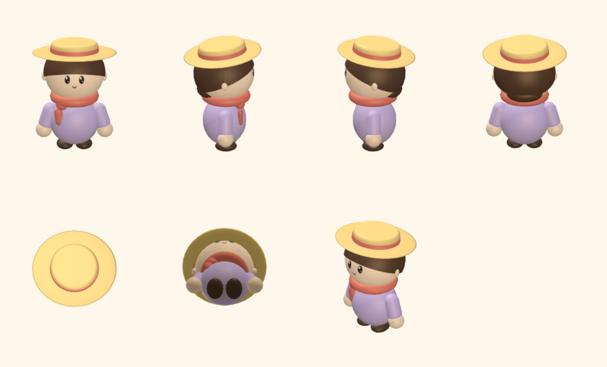
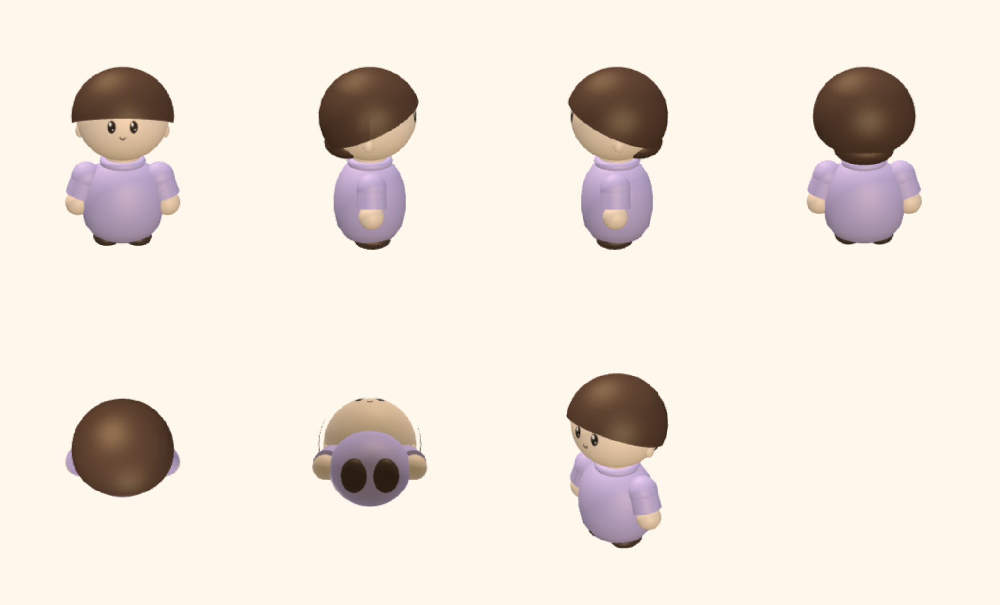
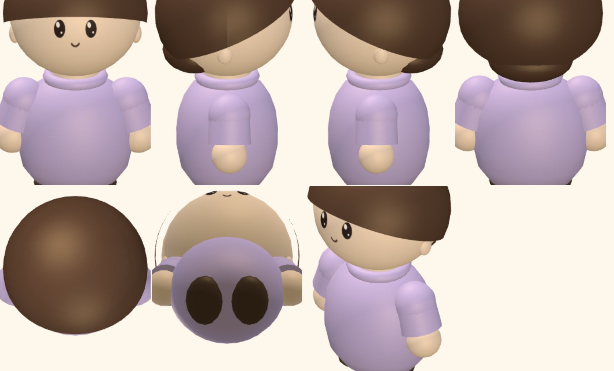
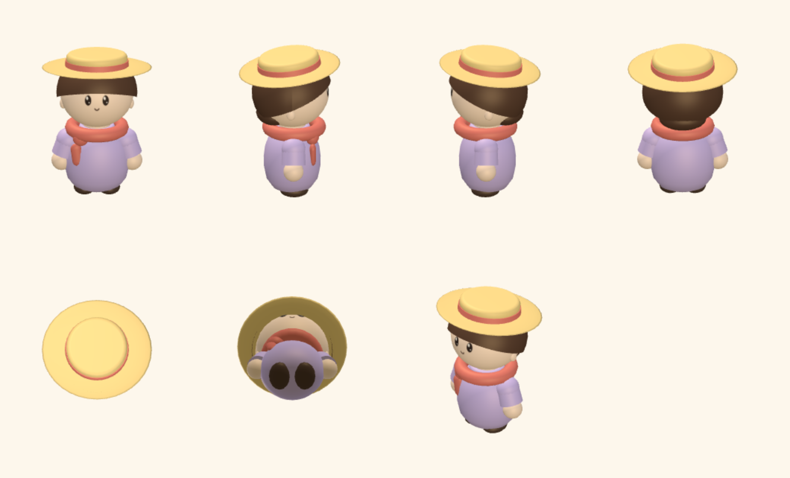
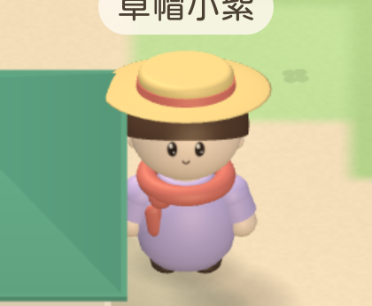
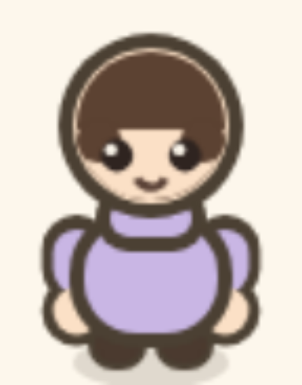
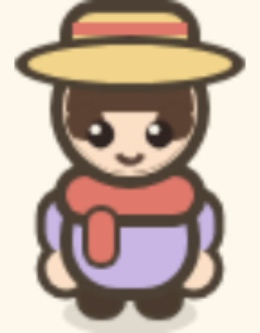

# Bare character pass visual QA

Validated on 2026-10-25 in Apple Container on macOS arm64. Builds, unit tests
and browser tests ran inside Linux containers; every image is a screenshot of
the built game taken by containerized WebKit.

## The brief

The character shipped in #29 was only ever reviewed wearing the straw hat and
the scarf. With both taken off — which is what the join screen opens on for a
player who clears them — three things the reference sheets call out were
missing or wrong. The sheets for this pass are the hatless turnaround and the
one with the hat, both carrying the same shoulder and arm breakdown.

## What was wrong, and what it is now

**No neck, no collar.** The head sat straight on the body ball. The sheet's
`肩膀結構` panel is explicit about a round collar (`圓領`) with a short neck
above it. There is now a neck, and the shirt gathers into a collar ring around
it.

**The torso had no shoulders.** A plain ball is already narrowing by the
height the arms attach, so the sleeves hung off the side of it with a gap. The
torso is now turned from a profile instead of being a scaled sphere: belly at
its widest, still broad across the shoulders, then drawn in to the collar. One
surface, so unlike a second shoulder ball there is no seam to shade. A rounded
shoulder cap over the top of each sleeve blends the joint.

**The arm was one long sleeve.** The sheet breaks it into three: a loose
cylindrical sleeve (`袖子`), a bare forearm (`手臂本體`), then the hand
(`手掌`). It is now those three, measured down a single arm axis from the
shoulder, so the splay angle places all of them at once.

Also: the hair is fuller — a mushroom standing off the skull rather than
hugging it — and the ears are lower, clear of the hair's hem, as the side
views show them.

| Before (hat and scarf only review) | After (bare) |
| --- | --- |
|  |  |

The dressed version still reads, with the scarf covering the new collar:

 · [Full iPhone capture](iphone.png)

## The 2D view

The 2D sprite (`?view=2d`) follows at its own fidelity. At 36×52 with two-pixel
outlines the bare forearm is under a pixel and a short cuff this close to the
body reads as a lump, so there the sleeve runs the length of the arm and meets
the hand directly, and the collar band stands in for the neck. Each arm is
outlined in one pass and filled in another, so no dark seam appears where the
sleeve meets the hand.

| Bare | Dressed |
| --- | --- |
|  |  |

## Automated validation

- Node 22-slim container: `npm run typecheck` clean, `npm test` — **190 passed**.
- Playwright v1.64.1-noble container, 4 GB / 6 CPUs — **72 passed** across
  iPhone, iPhone landscape, iPad and iPad landscape.
- The geometry test still covers all 25 hat/accessory combinations for finite
  coordinates, ground contact and the name-tag anchor at the camera angle; the
  taller head and new hat placement stay inside it.

## Limits

Device emulation in WebKit is not a real iPhone. The bare and the
hat-and-scarf outfits were reviewed view by view; the other hats and
accessories have geometry coverage, not a visual approval.
