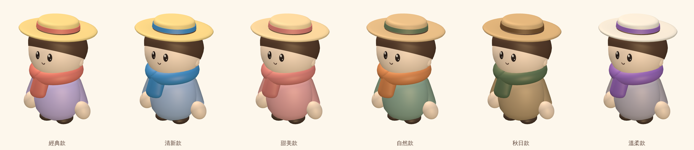
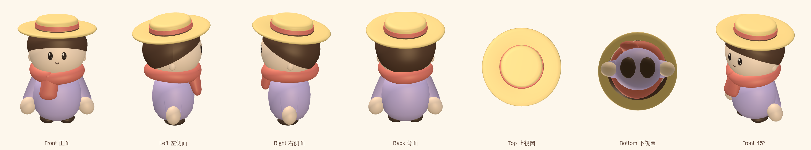
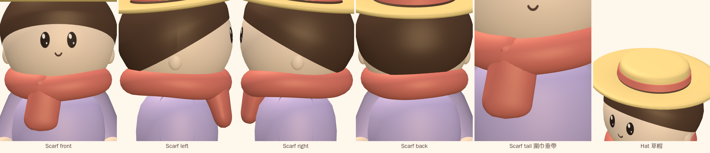

# Fixed character, color-only customization

Status: implementation prepared on `character-phase1`; awaiting visual approval.
Date: 2026-10-25.

## Handoff audit

Claude had already implemented substantial uncommitted work, rather than
remaining in exploration: fixed hat/scarf geometry, palette shader and material
cache, shared body/arm geometry, color-only join UI, and updated tests. The last
commit was `397d84d` (Phase 3 scarf). The rejected scarf was still described in
the Phase 3 report; its replacement had an approximate stepped tail path, open
tips and a lighting seam. The full reference-color and performance review was
unfinished.

## Completed

- Permanent rounded straw hat, fixed ribbon and scarf. Removed accessory
  selection from both client API and shared network protocol. Legacy extra
  fields are discarded by the server parser.
- Central `CharacterColors` and reference palettes in
  `packages/client/src/gfx/characterColors.ts`, shared by 2D and 3D.
  The six reference palettes appear in the join screen's color selection
  (two additional color palettes remain).
- One cached body geometry and one cached arm geometry for all palettes.
  One Phong material per distinct palette; changing colors swaps the cached
  material without rebuilding geometry. Faces retain the existing texture
  and geometry.
- Scarf has an uneven thick wrap, overlapping cloth and a continuous cubic
  transition into one broad short tail. The cross-section frame turns with
  the fabric; tips close with rounded hems and duplicated seam normals agree.
  It uses 112 × 20 × 2 = 4,480 triangles, below Claude's unfinished 4,800.
- Base head, hair, torso, shoes and arm positions/normals retain their approved
  construction and dimensions. Changes to the base module only assign palette
  slots and remove optional hair geometry. Existing separate arm groups and
  walk animation are preserved. Fixed accessories continue using the existing
  merged body mesh; no new draw calls are introduced.

## Actual model renders

These are WebKit renders of the TypeScript model using town lights, not generated
concept art. The reference sheet remains the artistic target; this delivery does
not claim pixel-identical reconstruction of it. In particular the approved base
hairline and shoulder intersection curves are preserved, so their differences
from the reference remain visible for review.







Regenerate with the Vite client running in the same environment:

```sh
node scripts/character-review.mjs
```

The script fails on browser/shader errors. `render-metrics.json` records one body
and one arm geometry across all six colors, with six palette materials.

## Performance target

Original draw-call target remains **150**. The existing Phase 1 regression
ceiling of 162 is retained, not raised. The earlier report calls this an accepted
deviation; the present run reports the excess explicitly.

Thirty remote characters plus the local player:

| WebKit device | Draw calls | Difference from 150 | Triangles |
| --- | ---: | ---: | ---: |
| iPhone portrait | 126 | within | 514,917 |
| iPhone landscape | 144 | within | 541,177 |
| iPad portrait | 120 | within | 496,068 |
| iPad landscape | 158 | +8 | 586,575 |

The body and two independently animated arms cost three calls per character;
faces and shadows remain instanced. No geometry or palette allocation occurs
during movement. This software-rendered test establishes submission cost and
correctness; a physical iPhone test is still needed to establish the 60fps goal.

## Review

Open `/turnaround.html?sheet=turnaround`, `?sheet=closeups` or
`?sheet=variants` on the development server. In the game, choose a skin and
color palette, join, and walk to check arm animation. The hat/scarf remain fixed.
Stop here for visual approval; no deployment or subsequent design phase.

The crowd exceeds the **300,000-triangle threshold used by the stationary
visual scenarios**. Those scenarios still pass their unchanged threshold; the
existing crowd test does not enforce that triangle limit. No threshold was
increased here. The software renderer reports approximately 4–9fps for this
stress scene, so **60fps has not been demonstrated**. See
`crowd-metrics.json` and the four `crowd-*.png` captures.

## Automated validation

- Type checking, ESLint and production build passed.
- 198 unit tests passed.
- 72 WebKit regression tests passed across all four device profiles.
- After the final scarf tessellation reduction, production build and all four
  crowd tests passed again, including browser/shader error assertions.
- Visual capture script passed: seven views, six closeups, six palettes;
  one body geometry and one arm geometry shared across all palettes.
- Production build retains the existing large-chunk warning.
