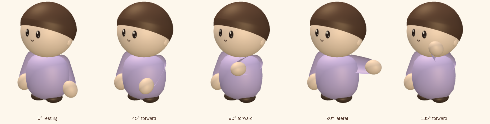
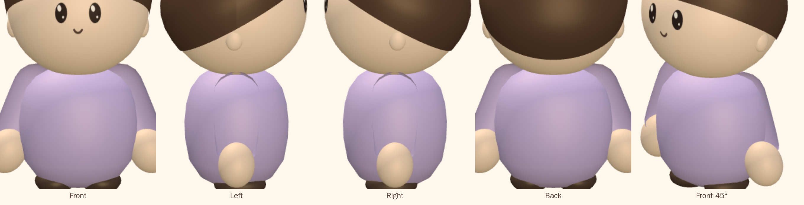
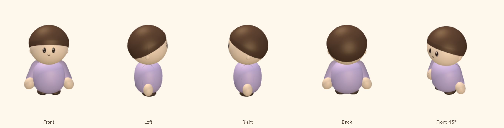

# Phase 1 — base character

**Status: waiting on review. No scarf, no hat.**

Validated on 2026-10-25 in Apple Container on macOS arm64. Builds, unit tests
and browser tests ran inside Linux containers; every image is a render of the
same geometry the game uses, under the town's own lighting, through an
`OrthographicCamera` so no view's proportions are bent by perspective.

## Arm poses

The same arm at 0°, 45° forward, 90° forward, 90° lateral and 135° forward.
Each is the one geometry with its group rotated — nothing is rebuilt per pose.
No holes, no floating parts, no exposed flat caps, and the shoulder stays
attached throughout.



## Resting pose, close

Front, left, right, back, front 45°.



## Seven views



## The shoulder

### What the seam actually was

Two convex surfaces that cross leave an intersection curve, and the eye reads
it as a seam wherever the surfaces meet at a shallow angle — a long, thin,
dark line. Three things were fixed, in order of how much they mattered:

1. **A separate cap is a second seam.** An earlier attempt put a ball on the
   joint as its own mesh. It worked for the pose coverage and looked worse:
   the ball read as a knob with a boundary of its own, on top of the boundary
   it was meant to hide. The shoulder is now the **top half of the sleeve's
   own turned profile** — one surface from the joint to the cuff, so there is
   no cap boundary at all.
2. **The crossing angle.** The joint sits inside the upper torso, so the part
   of the sleeve outside it exits where the torso's surface is already
   turning over. What is left at rest is a short soft arc at the very top of
   the shoulder, visible in the left and right views. That arc is the
   intersection itself.
3. **A tone step.** The arm's vertex colours are baked in the arm's own space
   and then rotated, so they cannot be keyed to world height the way the
   torso's are. Its ramp now *starts at the brightness the torso has at the
   joint's height*, computed from the same shade, so the arm no longer steps
   in tone where it meets the body. The lathe is also turned at 40 segments
   rather than 28, so the crossing curve is smooth rather than faceted.

Nothing is hidden with a material, a texture or a shadow, and no socket is
carved into the torso. **The remaining short arc at the top of the shoulder is
the honest limit of rigid overlapping meshes** — two separately rotating solids
cannot meet without an intersection curve somewhere. Removing it entirely needs
the deformable shoulder transition the brief mentions, which is a bigger change
than this iteration and is not done here.

### Why no pose can open it

Everything on the arm above the joint lies on or inside **one sphere centred on
the pivot**, and the sleeve's upper end *is* that sphere's top half. A sphere
about its own centre is unchanged by rotation, so the volume filling the socket
is identical at every angle: turning the arm cannot uncover anything the
resting pose was covering. Two tests hold it — that no vertex above the joint
reaches past the joint's radius, and that enough of them sit exactly on it that
it really is the sphere rather than merely inside one.

### Mesh hierarchy

```
root                       position, heading, scale
├── body mesh              torso, head, hair, ears, shoes
├── arm-left   group   at (-pivot.x, pivot.y, pivot.z)
│   └── arm mesh           sleeve + hand, built hanging down -y from the origin
└── arm-right  group   at (+pivot.x, pivot.y, pivot.z)
    └── arm mesh           the same geometry, turned the other way
```

Each arm is built in its own space with the origin **on** the joint, so the
group's own rotation is a rotation about the joint and nothing else.
`poseArm(side, pitch, splay)` sets it: positive splay swings the hand away
from the body on either side, positive pitch swings it forward. Both sides
share one geometry — the arm is a surface of revolution about its own axis, so
its mirror image is the same shape turned, which avoids a negative scale (that
would flip the winding and cull the arm away). The arms swing in antiphase as
a character walks.

### What it costs

A character is three draw calls instead of one. Measured with thirty avatars
in frame: **126** on iPhone, **158** in iPad landscape, against about 90
before. The budget in the 3D spec moved from 150 to 180 to match, with the
reason written next to it. Faces and blob shadows are still one
`InstancedMesh` each for the whole crowd. If that cost ever needs to come
back down, batching the arms is the lever, and it would cost the per-arm
groups.

## Preserved, as asked

Head and torso proportions, torso volume and profile, the resting arm shape
and the hand geometry, eye and mouth placement, shoe size and position, and
every colour. The hair is untouched in this iteration.

## Architecture

```
three/character/proportions.ts   every measurement, one coordinate system
three/character/baseCharacter.ts body parts, and the arm in its own space
three/character/scarf.ts         independent component
three/character/hat.ts           independent component, stacked from HEAD_TOP
three/character/accessories.ts   glasses, satchel, bowtie
three/character/index.ts         assembly, showHat / showScarf, poseArm
```

## Automated validation

- `npm run typecheck` clean; `npm test` — **197 passed** (7 new).
- Playwright v1.64.1-noble, 4 GB / 6 CPUs — **72 passed** across iPhone,
  iPhone landscape, iPad and iPad landscape.
- New tests cover both toggles, that no arm is baked into the body, that each
  arm's group sits on its joint, that posing one arm leaves the other alone,
  that the hand stays one arm's length from the joint at every angle tried
  (including 90°), that the shoulder is a sphere about the pivot, that the
  joint is inside the torso, and that the character is symmetric left to right
  to six decimal places.

## Not in this phase

Scarf (Phase 3) and hat (Phase 4) are untouched beyond living in their own
files. They still render in the game from the same toggles, so nothing a
player has picked has stopped working — they have simply not been fitted to
the new head and shoulders yet.
