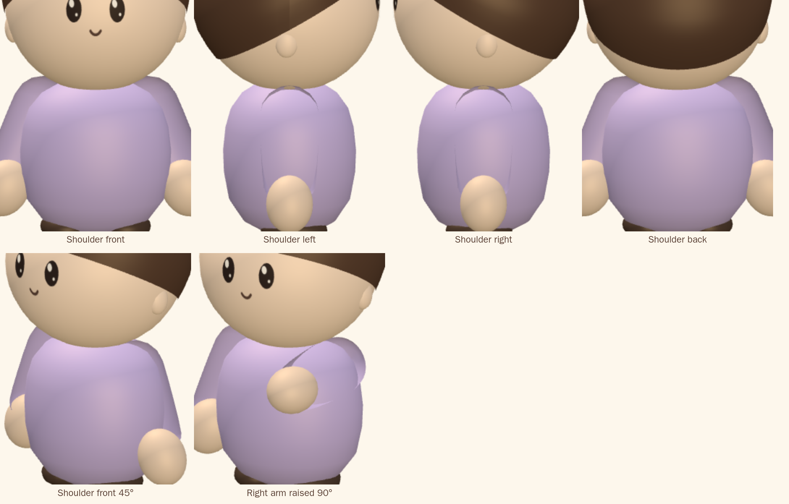

# Phase 1 — base character

**Status: waiting on review. No scarf, no hat.**

Validated on 2026-10-25 in Apple Container on macOS arm64. Builds, unit tests
and browser tests ran inside Linux containers; every image is a render of the
same geometry the game uses, in the same resting pose, under the town's own
lighting, through an `OrthographicCamera` so no view's proportions are bent by
perspective.

## Shoulder validation

Front, left, right, back, front 45°, and one arm raised 90° forward. The
raised arm is the same geometry posed by rotating its group — no hole opens at
the shoulder, and the shoulder does not detach.



## Seven views


## What the shoulder-to-arm construction replaced

The previous build had the joint **on** the torso's surface with a lathe whose
upper end was an elongated dome. Two things followed from that, and both were
rejected:

- From the front and back, the dome stood up past the torso as a **point**,
  because it was taller than a hemisphere of the same radius.
- From the side, the sleeve **grazed** the torso's surface over a long shallow
  stretch. Two surfaces crossing at a shallow angle draw a long thin crease —
  the **U-shaped groove**. Moving or rotating the sleeve only moved the groove,
  which is why that was the wrong thing to keep adjusting.

What replaced it:

| | Before | Now |
| --- | --- | --- |
| Joint | on the torso surface, pushed forward of its centre | **inside** the upper torso: `pivot.x` 0.177 against a torso radius of about 0.21 at that height |
| Upper end | a dome 0.122 tall over a radius of 0.109 | a **true hemisphere**, 0.098 over 0.098, so it swells instead of peaking |
| Sleeve | one turned surface, dome plus taper | still one turned surface, but tapering gently over a longer run so it **extends diagonally out and down** past the belly |
| Hand | sphere scaled 1.16 along the arm | ellipsoid, stretch 1.18, plugging the cuff from inside |
| Wrist | a ring of skin showed between cuff and hand | the cuff overlaps the hand by 0.062, and the hand is wider at the hem than the hem is — nothing shows through |
| Arms | merged into the body mesh | **their own meshes, in their own groups** |

Because the cap is a hemisphere centred on a joint that sits inside the body,
the part of the sleeve outside the torso reads as a rounded shoulder swelling
out of it, and the crossing happens where the torso's surface is steep — behind
the sleeve from every camera. No socket is carved into the torso, nothing is
hidden with a material or a shadow, and the overlap is the only thing doing the
work.

A test holds the premise: the joint must be inside the torso's turned profile
at its own height, and the sleeve radius must be large enough that the cap
still clears the surface.

## How the pivots work

```
root (position, heading, scale)
├── body mesh            torso, head, hair, ears, shoes
├── arm-left   group  at (-pivot.x, pivot.y, pivot.z)
│   └── arm mesh         sleeve + hand, built hanging down -y from the origin
└── arm-right  group  at (+pivot.x, pivot.y, pivot.z)
    └── arm mesh         the same geometry, turned the other way
```

Each arm is built in its own space with the origin **on** the joint, so the
group's own rotation is a rotation about the joint and nothing else.
`poseArm(side, pitch, splay)` sets it: positive splay swings the hand away from
the body on either side, positive pitch swings it forward. Both sides share one
geometry — the arm is a surface of revolution about its own axis, so its mirror
image is the same shape turned, which avoids a negative scale (that would flip
the winding and cull the arm away).

The arms are no longer merged into the body, so they move independently and at
runtime: they now swing in antiphase as a character walks.

Each character costs 3 draw calls instead of 1. Measured with thirty avatars
in frame: **126 of the 150 budget**, up from 74. Faces and blob shadows are
still one `InstancedMesh` each for the whole crowd.

## Preserved, as asked

Overall height, head-to-body ratio, torso volume and profile, eye and mouth
placement, shoe size and position, and the lavender are all untouched. The
hair is as approved in the previous round: one shell cut by a single tilted
plane, which is why the hem reads as one smooth contour from every angle, with
no nape lump.

## Architecture

```
three/character/proportions.ts   every measurement, one coordinate system
three/character/baseCharacter.ts body parts, and the arm in its own space
three/character/scarf.ts         independent component
three/character/hat.ts           independent component, stacked from HEAD_TOP
three/character/accessories.ts   glasses, satchel, bowtie
three/character/index.ts         assembly, showHat / showScarf, poseArm
```

## Automated validation

- `npm run typecheck` clean; `npm test` — **196 passed** (6 new).
- Playwright v1.64.1-noble, 4 GB / 6 CPUs — **72 passed** across iPhone,
  iPhone landscape, iPad and iPad landscape.
- New tests cover both toggles, that no arm is baked into the body, that each
  arm's group sits on its joint, that posing one arm leaves the other alone,
  that the hand stays one arm's length from the joint at every angle tried
  (including 90°), that the joint is inside the torso, and that the character
  is symmetric left to right to six decimal places.

## Not in this phase

Scarf (Phase 3) and hat (Phase 4) are untouched beyond living in their own
files. They still render in the game from the same toggles, so nothing a
player has picked has stopped working — they have simply not been fitted to
the new head and shoulders yet.
