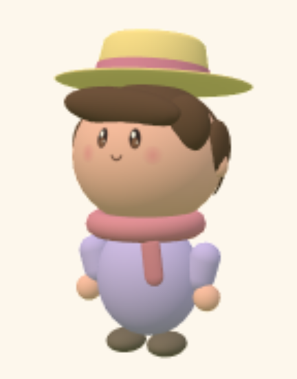
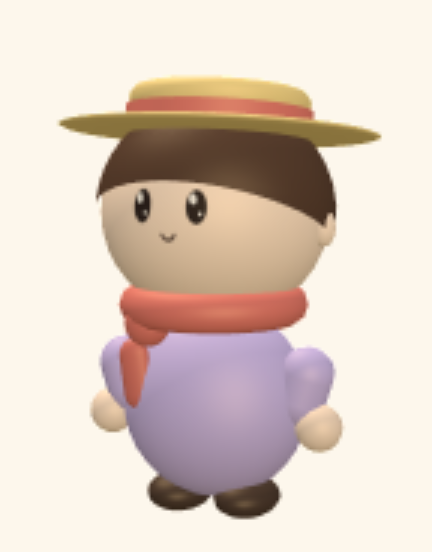
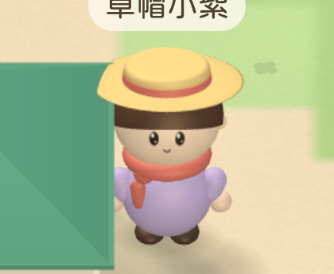

# Character redesign visual QA

Validated on 2026-10-25 in Apple Container on macOS arm64. Builds, unit tests
and browser tests all ran inside Linux containers; every image below is a
screenshot of the built game taken by containerized WebKit, not an
illustration.

## The target

The brief was a seven-view turnaround of a soft vinyl toy: a head half the
figure's height sitting straight on a round lilac body, a chocolate bowl cut,
a straw boater with a coral band, a coral scarf knotted to one side, stubby
sleeves ending in bare hands, and two espresso boots. The parts that character
is built from — skin, outfit, hat, accessory — are the four a player already
picks on the join screen, so the look became the join screen's starting
outfit rather than a fixed costume.

## Turnaround

Seven orthographic views of the rebuilt 3D avatar, rendered from the same
geometry the game uses, under the same town lighting.

## In the game

| Before (avatar preview) | After (avatar preview) |
| --- | --- |
|  |  |

[Full iPhone capture](after-town.png)

The 2D sprite view (`?view=2d`) follows the same design in its own flat,
outlined style, sharing the hair, scarf, straw, boot and eye colours with the
3D builder so the two views dress the same character:

## What changed

- Proportions: head radius 0.30 at y 0.80 over a 0.25 body ball whose top is
  the collar, so there is no neck; boots sit just under the hem.
- Hair is a bowl cut: a crown cap plus a shell whose hem sweeps from just
  above the eyes at the front, past the ears, down to the nape. The shell is
  built by hand — a ring of sphere sections gives a staircase, because a
  section's hem is a single latitude.
- The straw hat is now a boater: flat crown, coral band, wide flat brim,
  still tilted back so the 32-degree camera sees the eyes.
- The face texture is two big dark eyes with a catchlight and a small smile;
  the blush is gone.
- Hair, scarf, straw, boot, eye and mouth colours moved to `gfx/avatar.ts` and
  are shared by both renderers.
- The join screen now marks the parts the default avatar actually wears; it
  previously always highlighted the first swatch and chip.

## Automated validation

- Node 22-slim container: `npm run typecheck` and `npm test` — **190 passed**.
- Playwright v1.64.1-noble container, 4 GB / 6 CPUs: `npx playwright test` —
  **72 passed** across iPhone, iPhone landscape, iPad and iPad landscape.
- The geometry test covers all 25 hat/accessory combinations for finite
  coordinates, ground contact and the name-tag anchor at the camera angle.
- Draw calls with the new geometry: 45 on iPhone, well under the 150 budget;
  thirty nearby avatars still pass their budget test.

## Limits

Device emulation in WebKit is not a real iPhone: GPU cost and battery are not
measured here. The reference outfit was reviewed view by view; other hat and
accessory combinations have geometry coverage, not a visual approval.
