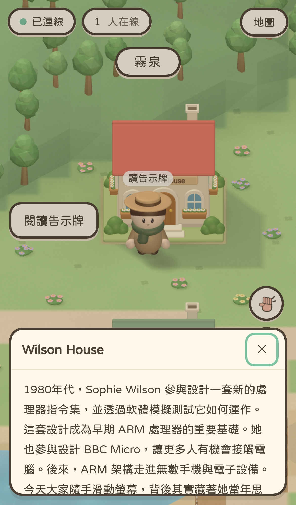
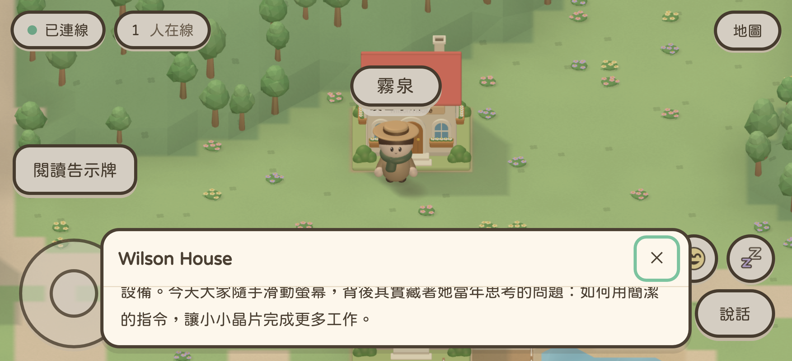
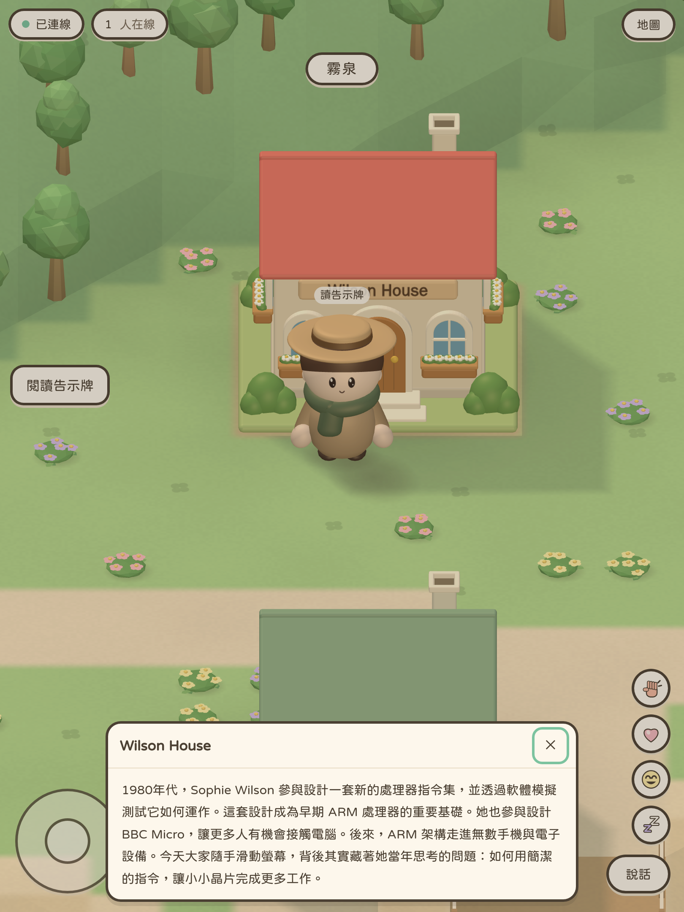

# House noticeboards

2026-10-25 · branch: `codex/house-noticeboards`

Standing in the single row immediately south of a house's 4 × 4 footprint
shows **閱讀告示牌** on the left of the screen. The whole front row counts;
standing beside/behind the house, farther away or on a removed plot does not.
The button is hidden before joining and disappears when the player leaves.

The native modal dialog displays the house name and its matching introduction.
All twelve introductions are copied verbatim from the user's supplied text.
Text is inserted using `textContent`.

The dialog's total height, including its header, is at most one third of the
visual viewport. Its body scrolls independently when necessary and has no
forced scrollbar when the text fits. The header/44px close target stay visible.
Close with the button, Escape or a backdrop click; focus returns to the reading
button. Reopening starts at the beginning of the story.

Reading pauses movement, cancels a pending walking route and reports the stop
to the server. Native modal focus/inertness isolates the controls; arrows can
scroll the story without moving the avatar. Key releases still reach the game
so previously held keys cannot become stuck. Closing restores normal movement.

No additional 3D geometry, draw calls, network message types or server-side
content storage are added. Both renderers share the same interaction and text.

## Validation

- Type checking, ESLint and production build passed.
- **217 unit tests passed**, covering all twelve house front rows, complete
  content coverage, excluded locations and pause/route cancellation.
- **16 WebKit scenarios passed**: two introductions (Wilson and Shockley),
  two renderers, four iPhone/iPad orientations.
- Browser checks cover exact displayed text, a left-side prompt, the one-third
  height limit, overflow scrolling on phones, pause/resume, close-button focus,
  Escape, scroll reset and prompt removal after walking away.
- One additional iPhone/3D test captured the initial scroll position.

Run `npm run build` followed by
`npx playwright test e2e/house-notices.spec.ts`.

## Previews

