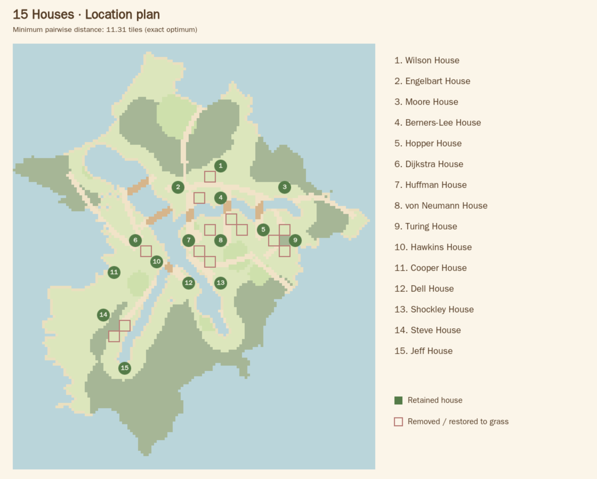
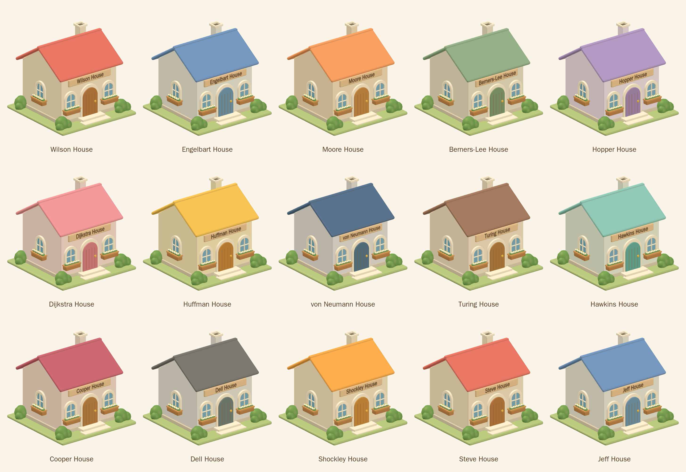
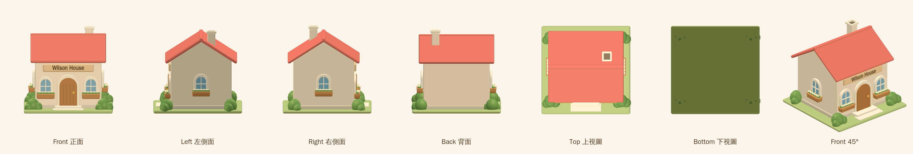
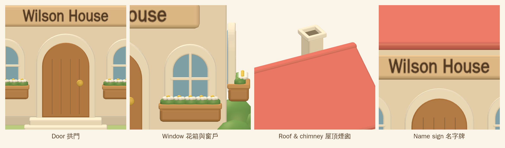
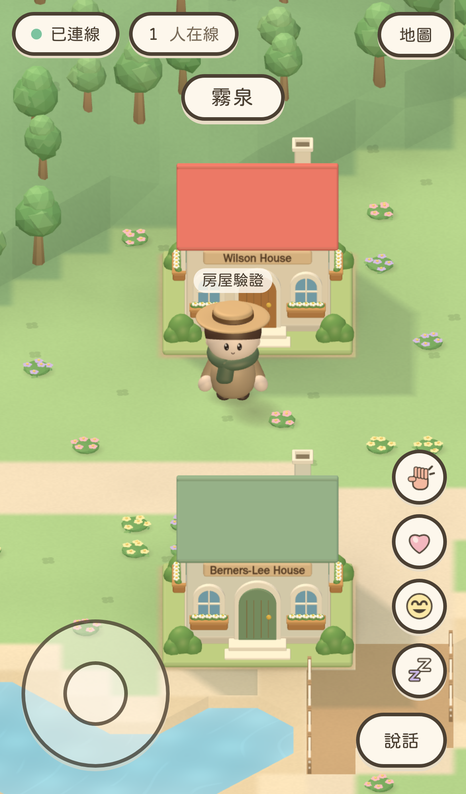
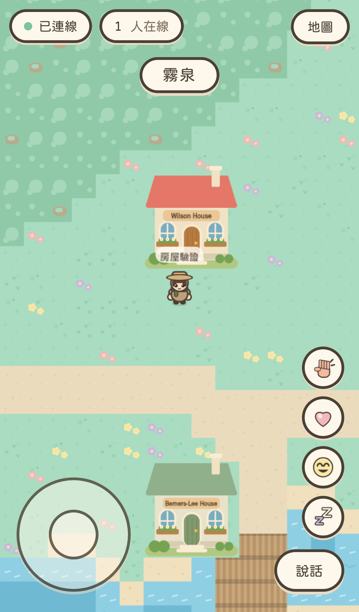

# Fifteen named reference cottages

2026-10-25 · branch: `codex/fifteen-named-houses`

## Placement

Retained fifteen of the existing twenty-eight plots using **exact max-min
Euclidean spacing** between plot centers. Since every plot is 4 × 4, center
and top-left distances are identical. The smallest squared distance is 128
tiles² (11.3137 tiles). An exact compatibility-graph search proves that no
fifteen original plots can achieve the next possible squared distance, 144.
Ties use stable north-to-south / west-to-east ordering.

The original candidates, selected coordinates and names are recorded in
`packages/shared/src/map/houses.json`. Removed building tiles become grass;
rendering and server collision both use the resulting shared terrain. One old
footprint had a road cut through five tiles; the retained Huffman House now
has a complete blocking footprint matching the model. Door approaches are
cleared of random trees/benches, without filling adjacent water.

District seed groups/positions are retained. District ownership is recalculated
using the existing walking-distance algorithm on the reclaimed terrain; its
deterministic test fingerprint is updated accordingly.

The map generator applies the same selection, preserves the original district
seed placement, and reproduces the checked-in map byte-for-byte.



| # | Name | Top-left tile x, y | Palette |
| --- | --- | --- | --- |
| 1 | Wilson House | 76, 44 | 1 |
| 2 | Engelbart House | 60, 52 | 2 |
| 3 | Moore House | 100, 52 | 3 |
| 4 | Berners-Lee House | 76, 56 | 4 |
| 5 | Hopper House | 92, 68 | 5 |
| 6 | Dijkstra House | 44, 72 | 6 |
| 7 | Huffman House | 64, 72 | 7 |
| 8 | von Neumann House | 76, 72 | 8 |
| 9 | Turing House | 104, 72 | 9 |
| 10 | Hawkins House | 52, 80 | 10 |
| 11 | Cooper House | 36, 84 | 11 |
| 12 | Dell House | 64, 88 | 12 |
| 13 | Shockley House | 76, 88 | 13 |
| 14 | Steve House | 32, 100 | 1 |
| 15 | Jeff House | 40, 120 | 2 |

## Model

One fixed cottage silhouette follows the supplied reference: cream gabled
walls, broad rounded pitched roof, hollow chimney, arched plank door and brass
knob, two front windows and one on each side, cream window frames, crossbars,
flower boxes, steps, corner shrubs and a rounded grass foundation.

The thirteen reference-inspired palettes repeat for Steve and Jeff. All
fifteen plaques use the requested names; none uses the sample name from the
reference. The name text uses a single shared texture atlas and material.
Color variants have identical vertex positions/normals. Each cottage is
14,460 triangles; repeated palette geometries are cached within the scene.
Each modeled footprint stays inside its 4 × 4 collision plot.

The 2D fallback uses a code-drawn front elevation with the same palette,
arched details, flowerboxes and matching name plaque. Images below are actual
WebKit renders of the TypeScript model, not generated concept art.







## Reproduce

With the Vite client running:

```sh
node scripts/house-review.mjs
```

This captures the seven views, fifteen named variants, detail views and location
plan and fails on browser/shader errors.

```sh
node scripts/build-map.mjs
npm run typecheck
npm run lint
npm test
npm run build
npx playwright test
```

The cottage-specific scenarios in `e2e/houses.spec.ts` stand south of Wilson
House and capture both renderers across the four WebKit device profiles.
Rendering budgets remain 150 calls / 300,000 triangles for stationary scenes;
the crowd scenario retains the existing explicit draw-call deviation ceiling.
Physical iPhone frame rate still requires device testing.

## Verification results

- Type checking, ESLint and production build passed.
- **202 unit tests passed**, including exact spacing optimality, fifteen names,
  collision footprints, reclaimed terrain, door approaches and invariant geometry.
- **72 existing WebKit regressions + 8 dedicated cottage scenarios passed**.
- The map generator reproduces the checked-in JSON byte-for-byte.
- Visual capture completed without browser/shader errors.

| WebKit device | Cottage scene calls | Cottage scene triangles | 31-character calls | 31-character triangles |
| --- | ---: | ---: | ---: | ---: |
| iPhone portrait | 37 | 114,150 | 120 | 558,524 |
| iPhone landscape | 51 | 157,387 | 138 | 589,906 |
| iPad portrait | 36 | 111,414 | 114 | 518,176 |
| iPad landscape | 63 | 217,082 | 152 | 704,722 |

Stationary cottage scenes remain below 150 calls and 300,000 triangles.
Crowd draw calls decrease by six in each profile relative to the preceding
character implementation, but crowd triangles increase with the detailed
cottages: the widest crowd scene is now 704,722 triangles. iPad landscape
still exceeds the original 150-call goal by two; the existing regression
ceiling is unchanged. This is a reported limitation, not a raised budget.
Software-rendered tests do not establish physical-device 60fps.

Actual game captures:





All four device/orientation captures for both renderers are saved beside this
report. Detailed counters are in `performance.json`.
