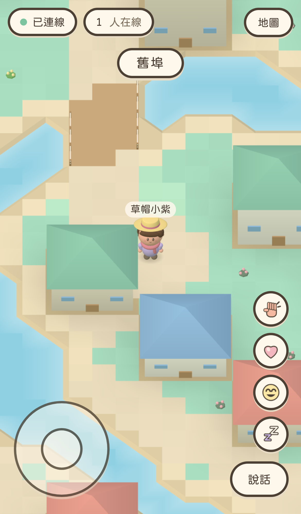
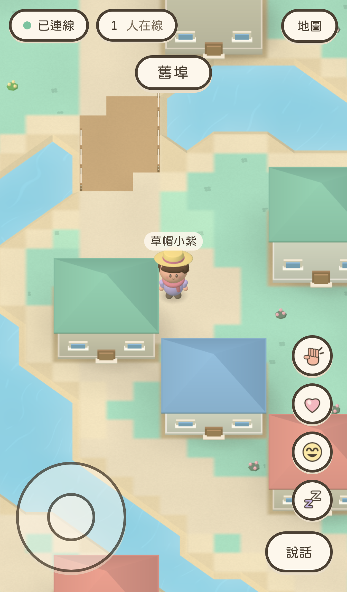

# Soft terrain and town detail: visual QA

Validated on 2026-10-24 from main bf6728104c7a71234aec9a5a7c2d4a055a858326, after PRs #18 and #19 were confirmed merged. Branch: feat/soft-terrain. All source edits, builds, tests and captures ran in Apple Container; the original tland-web and tland-game containers were left alone.

## Same-scene comparison

These are unretouched WebKit screenshots of the actual built game. Before rebuilt origin/main; after rebuilt this branch. Both use the same fixed-spawn test stack, selected avatar, camera, scale and 390x664 CSS viewport. The avatar and camera have not been changed in this pass.

| Before | After |
| --- | --- |
|  |  |

[1440x900 desktop capture](desktop.png)

## Observed changes and iterations

- First pass blended all terrain categories: the wooden bridge looked blurred, and the old shallow-water overlay still exposed rectangular color seams. That version was rejected.
- Final ground material narrows grass/path transitions, keeps bridge boundaries crisp, and adds subtle world-space pigment grain and scattered clover marks.
- One continuous water surface uses a small filtered shore-depth lookup, replacing the separate tiled shallows geometry. The rectangular water seams are gone; static broken ripples add detail.
- Existing instanced building parts gained foundation trim, roof thickness, window frames/sills, door surrounds and thresholds.
- Buildings now use the existing instanced soft contact-shadow layer. No real-time shadow maps or post-processing were introduced.
- Walkable tile geometry, picking heights, map data, movement, collision and WebSocket code were preserved.

## Validation

Node 22-slim container:

    npm test
    npm run typecheck
    npm run build
    npm run lint

All passed: **178 unit/integration tests**, Typecheck, Build and Lint. The existing large-bundle warning remains.

Official Playwright v1.64.1-noble container, 4 GB / 6 CPUs:

    npx playwright test

**32 passed** across iPhone/iPad portrait and landscape. Existing coverage includes tap movement, joystick pointer dragging/release, multiplayer bubbles/emotes, 30 nearby avatars and 2D view behavior. The visual scenario now also fails on browser console errors, including shader compilation failures.

Additional container runs passed:
- **1** desktop WebKit scenario at 1440x900, DPR 1, isMobile false and hasTouch false.
- **2** mobile WebKit scenarios at 375x667 and 430x932.

Temporary configs extending playwright.config.ts and full logs/captures are retained under qa-artifacts in the isolated worktree. Mobile and desktop screenshots were visually inspected, including the tall mobile view.

## Rendering evidence

Same stationary 390x664 view:

| Metric | main baseline | This branch |
| --- | ---: | ---: |
| Draw calls | 37 | 35 |
| Triangles | 100,782 | 100,774 |

The new palette and shore-depth data total 108,800 bytes (about 106 KiB), with no mipmaps. Unit tests check that budget, grass/bridge masks, shore depth, explicit GPU texture disposal, and zero corner heights on every walkable tile.

These draw counters establish similar geometry cost, not improved real-device frame time: fragment work has increased. Noise hashing avoids trigonometry, and grass detail uses a fixed rotation to limit per-pixel work, but real iPhone GPU/battery testing remains necessary.

## Remaining visual work

The logical coastline still follows the tile map and can look angular. Vegetation remains sparse, water ripples are static, and shadows are contact blobs rather than the reference image's directional cast shadows. More natural shore geometry and denser planting need a separate visual pass with collision/picking checks.

No production deployment, merge or production settings change was performed.
