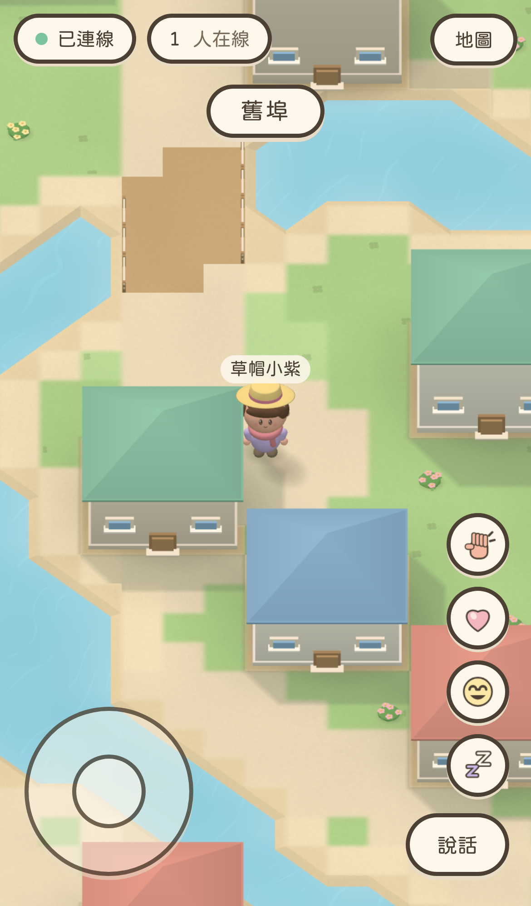
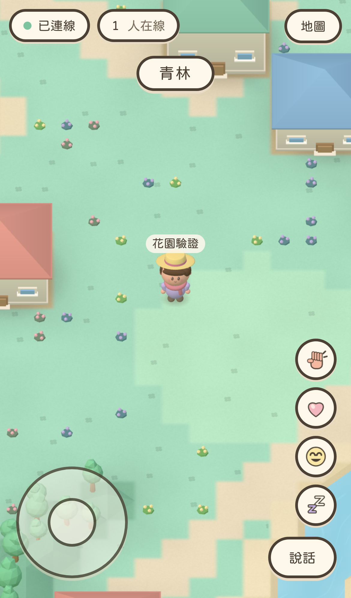
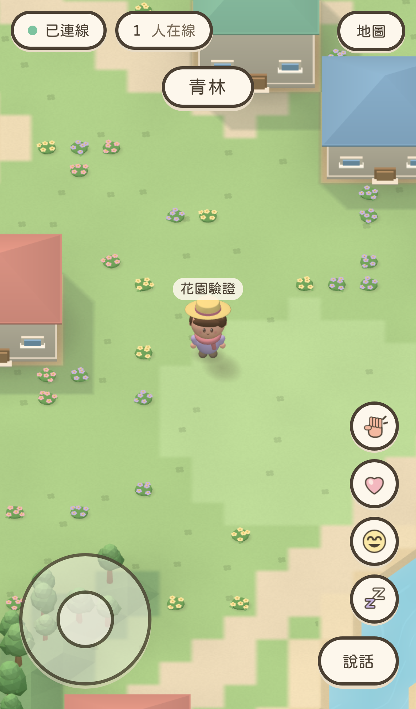

# Sunlit garden: visual QA

Validated on 2026-10-24 in Apple Container. Branch: feat/sunlit-garden, based on main 0b7f11ba059e05598f553e98e2029ca4cd13dbc7 after PR #20 was confirmed merged.

## Actual game comparison

All images are unretouched WebKit screenshots from the built game inside the official Playwright container. Before rebuilt main; after rebuilt this branch. Each pair uses the same server spawn, avatar, camera, scale and 390x664 CSS viewport.

| Residential before | Residential after |
| --- | --- |
|  |  |

| Garden before | Garden after |
| --- | --- |
|  |  |

[Woodland capture](woodland.png) · [1440x900 desktop capture](desktop.png)

## Visual changes

- Shared warm sunlight, cool sky bounce and restrained front fill give roofs, walls and avatars clearer light/dark separation. Preview and world use the same light setup.
- Ground color shifts from mint toward warmer planted greens.
- Existing flower points now hold five-flower beds with separate tinted petals, yellow centers, green leaves, a low mound and contact shadow. Their locations and non-blocking behavior are unchanged.
- Trees gain layered crowns. Ordinary house walls are slightly taller to improve their proportions; building footprints are unchanged.
- Buildings and flat-ground trees get soft sun-aligned ground silhouettes. Player contact blobs are retained with an additional sun-aligned oval in the same instance batch.

## Iteration and cost control

The first prototype looked richer but submitted 770,946 triangles in the residential view, so it was rejected. Petals/leaves were simplified, tree crowns reduced, degenerate projection triangles removed and single-sided shadow meshes used. Foliage regions were then reduced from 32 to 16 tiles so narrow phone views do not submit entire distant groves. The final flower mound was added after reviewing the remaining flat/sticker-like appearance.

Same stationary mobile views, one player:

| Scene | Before calls | After calls | Before triangles | After triangles |
| --- | ---: | ---: | ---: | ---: |
| Residential | 35 | 41 | 100,774 | 48,852 |
| Garden | 27 | 40 | 103,816 | 80,737 |
| Woodland | 35 | 42 | 72,394 | 74,225 |

These counters describe draw submission and geometry, not actual iPhone frame time. More light/fragment work and extra calls still require device GPU/battery verification.

## Automated validation

Every source edit, dependency command, test, build and browser capture ran in Apple Container. No host Node/npm installation.

Node 22-slim:

    npm test
    npm run typecheck
    npm run build
    npm run lint

All passed: **181 unit/integration tests**, Typecheck, Build and Lint. The existing bundle-size warning remains.

Official Playwright v1.64.1-noble, 4 GB / 6 CPUs:

    npx playwright test

**40 passed** across iPhone/iPad portrait and landscape. The new deterministic garden/woodland captures fail on browser/shader console errors and enforce under 150 draw calls and 300,000 triangles for stationary scenery. Existing movement, joystick pointer release, multiplayer, 30-player drawing and 2D behavior coverage stays in place.

Additional temporary configs extending playwright.config.ts:
- **3 passed** at desktop 1440x900, DPR 1, isMobile false, hasTouch false.
- **6 passed** across mobile viewports 375x667 and 430x932, covering all three scenes.

New unit checks exercise sun direction, projected geometry clipping away from water/hills/building receiver tiles, alpha feathering, all-water scenes and a full room of paired player-shadow instances.

Full logs and all device captures remain in qa-artifacts in the isolated worktree. The original tland-web and tland-game containers were not changed.

## Limits

These are stylized ground projections, not real-time shadow maps. They do not shade other 3D objects, self-shadow, or follow sloping hill surfaces. The extra decorative hill trees retain their existing terrain shading. Player directional shadows are ellipses. Shore geometry is still angular, water ripples static, and the scene still differs from the reference's richer material and lighting treatment.

No camera zoom/avatar scale, map data, collision, movement or WebSocket protocol changes were made. No merge, production deployment or production configuration change was performed.
